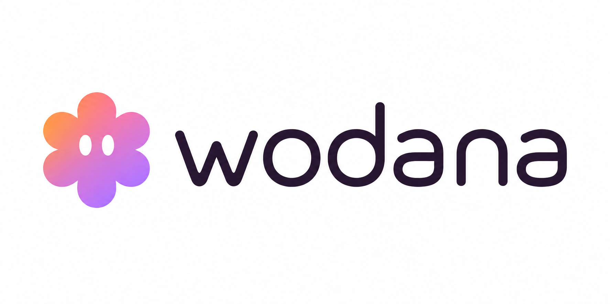

# Wodana — rounded wordmark refinement



One refined horizontal logo based on direction B. Softened stroke endings and curved joins replace sharp letter edges. Woddy remains separate, beside the full lowercase wordmark, in the established lilac/rose/peach palette.

Generated using the imagegen skill and built-in image-generation tool. The supplied typography study was used as the edit reference. This is a raster branding asset, not a vector master. Existing application logos remain unchanged.

## Final generation prompt

```text
Use case: logo-brand.
Input image: typography study. EDIT AND REFINE ONLY THE MIDDLE OPTION B into one professional Wodana logo. Do not reproduce the study or give alternatives.
Primary request: the user accepts this direction but dislikes sharp letter edges. Make the lettering beautifully smooth and rounded while retaining a mature, professional SaaS identity.
Preserve: full exact lowercase word "wodana" (w-o-d-a-n-a, every letter present); a SEPARATE Woddy mascot to the left, never inside the word; deep plum-charcoal #2f232d lettering; the reference's six-lobed Woddy silhouette, two white oval eyes, and lilac #d6b9f3 / rose #e4a2bc / peach #f39b54 gradient.
Typography correction: use option B's contemporary soft construction as the starting point, but make every exposed stroke ending smoothly rounded. Round the upper terminals of the w, soften the w valleys, give the d ascender a rounded cap, smooth the a bowls and stems, and round the n stem endings. No square cuts, pointed corners, chamfers, notches, jagged joins or flat razor-like terminals anywhere. A refined medium-weight rounded humanist sans, with natural readable single-storey a, open counters, graceful curves, consistent strokes and expert optical spacing. Confident and elegant, neither thin nor chunky. Do NOT use inflated bubble lettering, novelty typography or a blocky heavy font. Keep a natural w width, not an oversized double-u.
Proportions: make the standalone Woddy symbol approximately the total letter height including the d ascender, aligned with the wordmark's optical vertical center. It should complement rather than overpower the name. Moderate gap between symbol and word, careful balanced kerning across the whole word.
Deliver ONE large complete centered horizontal logo on a pure white background, landscape composition, crisp vector-like edges and ample clean margin. No labels A/B/C, no guidelines, no divider lines, no duplicates, no dark panel, no slogan, no headings, no mockups, no texture, no shadows, no 3D rendering and no watermark. Only the complete Woddy-plus-wodana logo. It should be suitable as the visual master concept for a polished business software platform.
```
