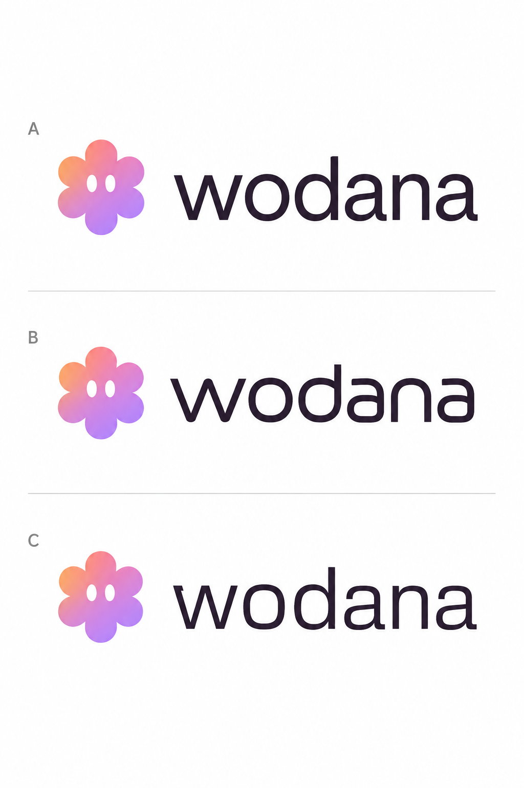

# Wodana typography study — 03



Three lettering concepts with Woddy kept separate from the complete wordmark. A is product-native and Inter-informed, B is softer and more distinctive, and C is more technical. These are generated visual directions, not exact licensed font specimens. The actual product currently loads Inter in apps/web/app/fonts.ts.

Generated with the built-in image-generation tool. Raster review asset; existing application branding is unchanged.

## Final generation prompt

```text
Use case: logo-brand.
Asset type: one refined typography comparison sheet for choosing the Wodana SaaS wordmark, not a finished brand rollout.
Reference image: the previous Wodana concept. Retain the standalone Woddy symbol from that reference: six rounded lobes, two white vertical oval eyes, lilac/rose/peach gradient. The client likes neither of the previous wordmark fonts: the first was too bubble-like and childish, the second too heavy, generic and blunt. The product interface uses Inter, with compact calm typography, soft lilac/rose/peach accents and clean modern surfaces.

Create a clean three-row typographic study, clearly labelled A, B and C in tiny neutral type at the far left. Each row contains the SAME unchanged small Woddy symbol beside the COMPLETE word "wodana", all six letters w-o-d-a-n-a, no letter substitution and no Woddy inside the word. Exact same icon, accent palette, wordmark visual size and arrangement across all rows. Change ONLY the type direction. The icon should support the name, never dominate it: about the word's ascender height, separated by a tasteful word-space gap. The wordmark is solid dark plum-charcoal #2f232d. Plain warm-white background, generous margins. Three large highly legible wordmarks stacked with subtle fine horizontal dividers and no unnecessary decoration. No dark panels, no mockups, no additional text besides the three labels A/B/C and the repeated exact word "wodana".

A: Product-native refinement. Compact Inter-informed contemporary humanist neo-grotesk, MEDIUM weight approximately 500, NOT bold. Subtle natural stroke modulation, a normal angular w, clean tall d, double-storey a, relaxed circular o. Elegant optical kerning a little tighter than body text. Clear, calm and highly legible. It should feel like the product's beautifully typeset identity.

B: Warm modern precision. A visibly different sophisticated soft geometric sans, medium weight, slightly narrower proportions, single-storey a with an upright stem, distinctive neatly notched angular w and open rounded n. Carefully shaped slightly squared circular counters. Restrained softness, flat terminals, NEVER balloon or bubble lettering. Friendly and premium, as a serious SaaS platform, not children's software.

C: Distinctive technical elegance. A crisp contemporary custom grotesk, regular-medium weight, slightly condensed width, double-storey a, subtly asymmetric o, compact letterfit, purposeful angled cuts at selected terminals. Quiet intelligent character, subtle precision, NOT a stencil, NOT sci-fi, NOT italic. More individual than a stock bold sans without sacrificing clarity.

Crucial: all three font designs must be noticeably distinguishable at a glance. None should be heavy, blocky, extra-bold, oversize-w, cartoonish, hand-drawn, ornamental, luxury serif, or look like the heavy typography in the reference. Focus entirely on excellent letter shapes and spacing. Vector-clean flat presentation with no texture, no embossed edges, no shadows, no gradients on text, no blue or green, no watermark. The only gradient is the unchanged separate Woddy symbol.
```
