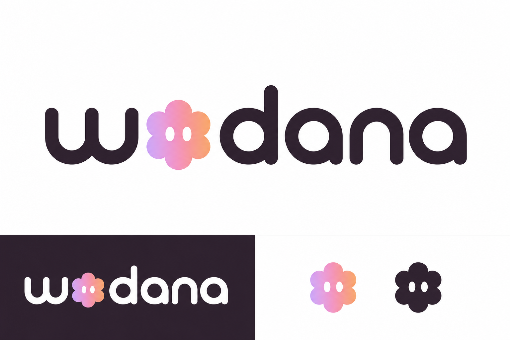

# Wodana × Woddy — logo concept 01



Woddy replaces the lowercase “o” in Wodana, keeping the platform's familiar lilac, rose, and peach palette. The presentation includes a light-background wordmark, a dark-background reversal, and standalone color and single-color marks.

Status: raster concept for branding review. Not a production vector master or a trademark-clearance result. Existing application logos are unchanged. Before rollout, finalize optical spacing and tiny-size reproduction in vector masters, and perform brand clearance.

Generated with the built-in image-generation tool, using the existing Woddy avatar as an identity reference.

## Final generation prompt

```text
Use case: logo-brand.
Asset type: a beautifully art-directed logo concept presentation for an existing premium SaaS business platform called Wodana, whose product covers CRM, team workspaces and project delivery with a friendly AI companion Woddy.
Input image 1: the platform's EXISTING Woddy mascot, to incorporate and intelligently simplify, not an unrelated illustration. It is a soft six-lobed flower-like character with two small vertical white oval eyes. Its silhouette and quiet friendly expression are the identity cues.
Primary request: Design an exceptional, original-feeling lowercase wordmark reading exactly "wodana", letter order w-o-d-a-n-a, with a refined Woddy symbol occupying the o position as an integrated letter. NOT an extra symbol next to an intact word. The logo should be instantly readable as wodana. Build an elegant, distinctive, warm SaaS brand identity, not a toy brand.
Design: custom rounded geometric sans-serif lettering, medium-bold confident weight, beautifully optically kerned, single-storey a characters, gently softened terminals, some subtle distinctive craft in the w. Keep the five typographic letters in rich charcoal #2f232d. The Woddy-o should be the only colorful character: a simplified compact six-lobed smoothly connected silhouette with the original two white oval eyes, unified gentle lilac #d6b9f3 to rose #e4a2bc to peach #f39b54 gradient. Its size should harmonize with the lowercase x-height, only a slight optical overshoot, no giant mascot towering over the letters. It must read as one word. Clean sharp vector-style outlines, strong silhouette, balanced negative space, no fuzzy edges. Preserve the personality of the mascot reference but simplify its individual spheres into an intentional coherent logo glyph. No cyan, blue, green, or rainbow; use ONLY the platform's lilac/rose/peach accent family. No shiny 3D blobs, no chrome or glass, no extruded text, no generic sparkle.
Composition: landscape branding presentation, very refined editorial layout with generous whitespace. The upper approximately 65 percent is plain warm white, featuring ONE very large horizontal primary wodana wordmark, centered, completely uncropped. The bottom is a tidy application strip: a charcoal panel on the left with the SAME wordmark in warm white and identical colored Woddy-o at a smaller size; on the right on warm white, show the SAME standalone Woddy-o mark at app-icon scale, plus a single-color charcoal silhouette version with its eyes knocked out white, to demonstrate that the identity works without a gradient. Keep all repeats completely consistent. Exact wordmark text only "wodana". No headings, labels, slogans, captions, fake trademarks, tiny illegible text, UI chrome, device mockups, or decorative background gradients. The brand itself is the hero. This should look like the strongest considered first presentation from an excellent identity designer, not a contact sheet of random logo ideas.
```
