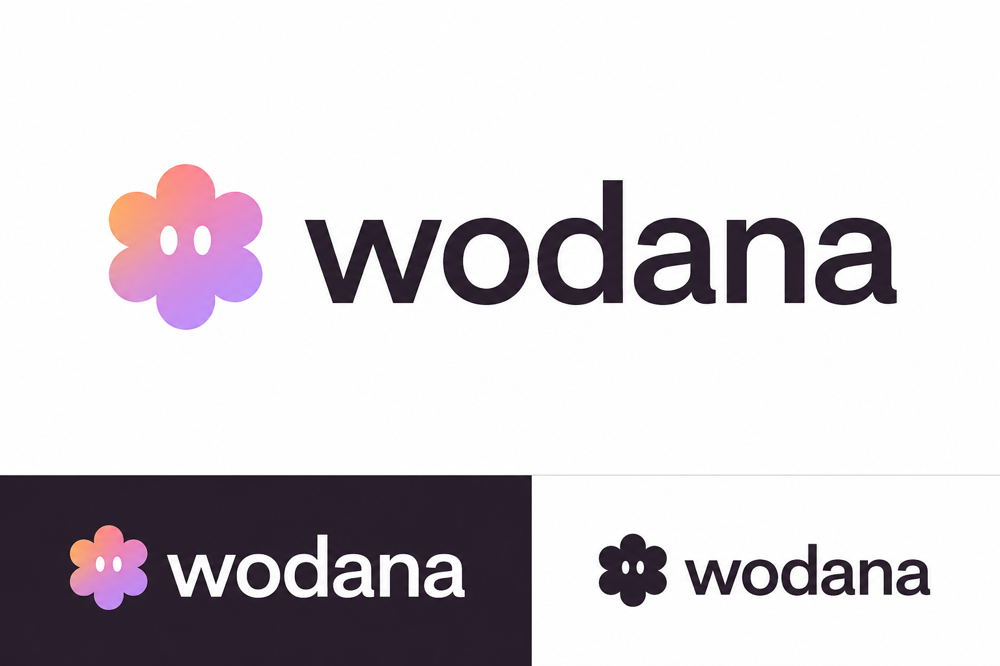

# Wodana × Woddy — logo concept 02



Revision: Woddy is a standalone symbol beside the complete wordmark. Sharper neo-grotesk lettering replaces the rounded lettering rejected in concept 01. The lilac, rose, and peach palette is retained.

Generated with the built-in image-generation tool using the existing Woddy avatar as an identity reference. Raster branding concept only; not a production vector master or a trademark-clearance result. Existing application logos are unchanged.

## Final generation prompt

```text
Use case: logo-brand.
Asset type: revised premium SaaS logo concept for Wodana.
Input image: Woddy, the existing six-lobed mascot with two white oval eyes, is an identity reference for the standalone symbol only.

IMPORTANT DESIGN CORRECTION: The client rejected rounded, bubble-like lettering and rejected placing Woddy inside the word. Do NOT replace any letter with the mascot. The exact complete word "wodana" must contain all six normal letters, w-o-d-a-n-a, including a normal o. Put a separate compact Woddy symbol to the LEFT of the whole word with a clear, deliberate gap.

Primary request: create a genuinely sophisticated, restrained SaaS identity, with beautifully drawn professional typography. Think excellent contemporary corporate identity craft: a custom neutral neo-grotesk, medium-semibold weight, sharp confident construction, double-storey a characters, a conventional angular lowercase w with diagonal stems, clean vertical d, natural balanced o, subtly softened corners only. NOT a geometric bubble font, NOT all circular letterforms, NOT pill-shaped terminals, NOT an extra-wide w, NOT cartoonish, NOT futuristic stencil or techno lettering. Optical kerning must feel exact. The wordmark is the star: legible, mature, polished, quietly distinctive, appropriate for a serious customer-management and business-operations platform.

Standalone symbol: simplify the supplied Woddy into a crisp connected six-lobed glyph retaining the two small white oval eyes. It should be slightly taller than the lowercase x-height, approximately the overall height of the word including d ascender, but not huge. Flatten the mascot into clean vector-like contours rather than puffy 3D spheres. Accent only this standalone symbol with a controlled lilac #d6b9f3, rose #e4a2bc, and peach #f39b54 gradient. Lettering is solid deep charcoal #2f232d. No green, blue or neon. Keep the symbol separate from the word, never overlapping the w or the o.

Composition: an immaculate landscape identity presentation on a plain warm-white background. One dominant large primary horizontal logo lockup centered in the upper two-thirds, generous whitespace but large enough to appreciate the typographic craft. Bottom third is a quiet two-part strip: on the left, the identical standalone-symbol-plus-complete-wordmark lockup reversed in warm white on deep charcoal with the same gradient symbol; on the right, a smaller one-color charcoal version of the exact same complete lockup on warm white. Typography and symbol proportions must be identical across versions. Avoid any additional text, headings, labels, taglines, icons, business cards, devices, UI mockups or background decoration. Crisp vector-style output. No bevel, shadows, texture, glass, metal or watermark. Spell "wodana" correctly and exactly each time. The result should look substantial and professional, not cute typography.
```
