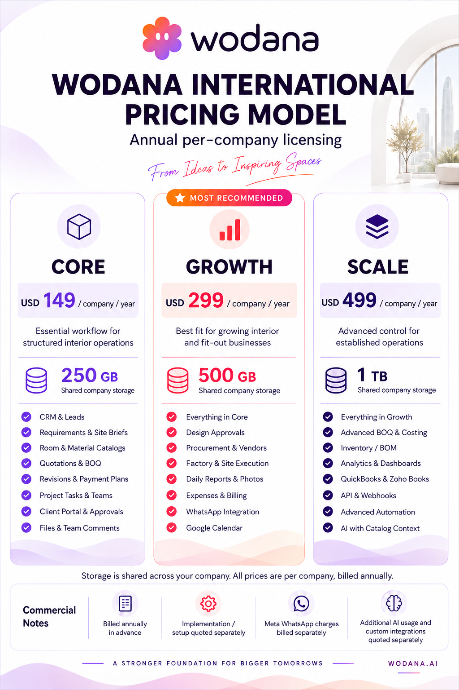

# Wodana pricing — per company, per year



| Plan | Annual company license (USD) | Shared company storage | AWS storage/month (USD) | AWS storage/year (USD) |
| --- | ---: | --- | ---: | ---: |
| Core | 149 | 250 GB | 6.25 | 75.00 |
| Growth | 299 | 500 GB | 12.50 | 150.00 |
| Scale | 499 | 1 TB | 25.60 | 307.20 |

The monetary amounts and four original commercial notes are unchanged. Licensing and storage are per company. No unlimited-user claim or seat limit has been added.

AWS estimate: S3 Standard in Middle East (UAE), me-central-1, first 50 TB, USD 0.025 per GB-month, assuming full use throughout the year and 1 TB = 1,024 billed GB. Source [AWS public regional price list](https://pricing.us-east-1.amazonaws.com/offers/v1.0/aws/AmazonS3/current/me-central-1/index.json), published 31 August 2026, checked 7 September 2026. The relevant rate is retained in [the local reference](aws-uae-storage-price-reference.json).

These estimates cover stored objects only. API requests, downloads/data transfer, extra copies/backups, application hosting, database services, support and tax are excluded. At full use, storage alone consumes roughly 50%, 50% and 62% of the respective annual company prices. Those percentages are not a full margin analysis. This artwork does not provision AWS storage or change production subscriptions/quotas; existing server storage is unchanged.

Generated with the built-in image-generation tool using the imagegen skill. Visually verified all three company prices, storage capacities, feature rows, commercial notes and removal of per-user wording.

## Storage addition prompt

```text
Edit this exact Wodana international pricing poster. This is a precise text/layout addition, not a redesign. Preserve the current Woddy mascot and lowercase wordmark, white background, plum typography, lilac/rose/peach theme, architectural arch, three aligned plan cards, every feature line, descriptions, all four commercial notes, the Growth MOST RECOMMENDED badge, and website WODANA.AI.

Add included STORAGE prominently to each matching plan:
CORE: "250 GB" with label "Shared company storage"
GROWTH: "500 GB" with label "Shared company storage"
SCALE: "1 TB" with label "Shared company storage"

Place an elegant compact storage row in each card between the plan description and its feature checklist, with a small matching database/storage outline icon and clear large capacity. All three storage rows must align. Give each checklist enough space below; increase the poster height slightly or reduce excessive decorative space if necessary, but never omit, crowd or clip existing content. Keep it premium, crisp and readable, white with restrained current-theme accents. Same portrait visual style and near-identical existing design.

Add one small clear line above the Commercial Notes strip:
"Storage is pooled across your company workspace. License pricing is per user."

ABSOLUTE PRICING INVARIANTS, VERBATIM:
CORE: "USD 149 / user / year"
GROWTH: "USD 299 / user / year"
SCALE: "USD 499 / user / year"
Keep "Annual per-user licensing". No other prices. Do not change currency, amounts, billing period, licensing basis or any price number. Do NOT show AWS wholesale costs, do not add AWS logos or claim AWS hosting. Do NOT say storage is per user. Storage is a capacity allowance, not a monthly allocation.

EXISTING FEATURE COPY MUST ALL REMAIN, in the same plan:
CORE: CRM & Leads; Requirements & Site Briefs; Room & Material Catalogs; Quotations & BOQ; Revisions & Payment Plans; Project Tasks & Teams; Client Portal & Approvals; Files & Team Comments.
GROWTH: Everything in Core; Design Approvals; Procurement & Vendors; Factory & Site Execution; Daily Reports & Photos; Expenses & Billing; WhatsApp Integration; Google Calendar.
SCALE: Everything in Growth; Advanced BOQ & Costing; Inventory / BOM; Analytics & Dashboards; QuickBooks & Zoho Books; API & Webhooks; Advanced Automation; AI with Catalog Context.

KEEP THESE FOUR COMMERCIAL NOTES VERBATIM:
"Billed annually in advance"
"Implementation / setup quoted separately"
"Meta WhatsApp charges billed separately"
"Additional AI usage and custom integrations quoted separately"

Preserve the title "WODANA INTERNATIONAL PRICING MODEL", tagline "From Ideas to Inspiring Spaces", all three plan descriptions from the input and footer "A STRONGER FOUNDATION FOR BIGGER TOMORROWS". Ensure the text is sharp, spelled correctly, aligned and comfortably readable. Deliver one finished updated sales poster at high resolution.
```

## Final company-licensing correction prompt

```text
Make a precise copy-edit to this finished Wodana pricing poster. The user has corrected the license basis: ALL plans are PER COMPANY, PER YEAR, not per user. Change only this billing wording; preserve all other design, storage capacities, logo, layout, features and monetary amounts exactly.

Required edits:
1. Replace the subtitle "Annual per-user licensing" with "Annual per-company licensing".
2. CORE price must read exactly "USD 149 / company / year".
3. GROWTH price must read exactly "USD 299 / company / year".
4. SCALE price must read exactly "USD 499 / company / year".
5. Replace the sentence above Commercial Notes with: "Storage is shared across your company. All prices are per company, billed annually."
There must be ZERO remaining "per user", "/ user", or "per-user" references anywhere in the image.
Do not claim unlimited users or introduce a seat limit.

INVARIANTS:
USD amounts stay exactly 149, 299, 499.
Storage stays CORE "250 GB", GROWTH "500 GB", SCALE "1 TB", with each labelled "Shared company storage".
Preserve Woddy-plus-wodana logo, the white/lilac/rose/peach theme, dark plum text, Growth MOST RECOMMENDED badge, architectural background, and all 8 feature rows in each plan without omissions.
Preserve all four notes unchanged:
"Billed annually in advance"
"Implementation / setup quoted separately"
"Meta WhatsApp charges billed separately"
"Additional AI usage and custom integrations quoted separately"
Keep WODANA.AI and all other text unchanged except the required edits above.
Fit the longer "/ company / year" wording cleanly on the price line with smaller supporting text if needed, while keeping the price numbers dominant. Keep alignment equal across the three columns, no clipping or overlap. Render the corrected final poster crisp and high resolution. Do not add AWS wholesale prices or any other price.
```

