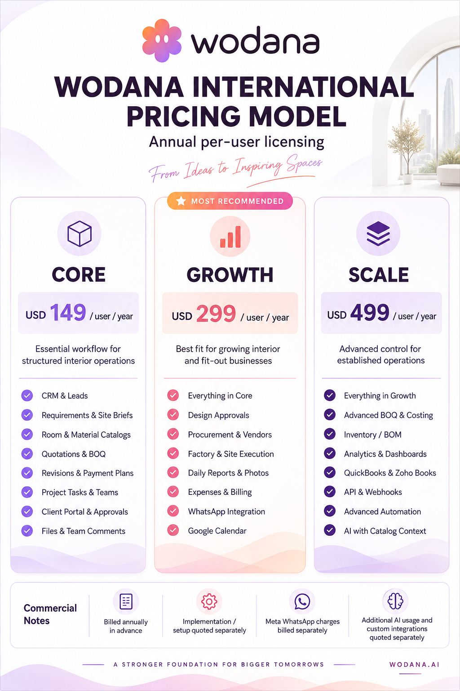

# Wodana international pricing sheet

Current edition: [company pricing with storage](COMPANY-PRICING.md). This supersedes the per-user artwork below.

Updated 7 September 2026 using the built-in image-generation tool (imagegen skill).



Preserved prices: Core USD 149, Growth USD 299, Scale USD 499, each per user per year. All four original commercial notes remain unchanged. Visually checked the final output for all three prices, billing basis, feature copy, logo, alignment and clipping.

The feature packaging is sales collateral based on the provided tier model and current product modules. This artifact does not change application billing, subscription entitlements or provider configuration.

## Final editing prompt

```text
Edit the supplied Wodana pricing-sheet image into its updated current-brand edition. Use case: style-transfer / marketing infographic.
INPUT 1 is the pricing sheet to edit. INPUT 2 is the exact CURRENT logo to use: separate six-lobed Woddy mascot with two white oval eyes, warm lilac/rose/peach gradient, followed by full lowercase rounded dark-plum "wodana" wordmark. Replace the obsolete blue W logo entirely with input 2. Keep this exact new logo geometry and lowercase lettering, no invented symbol.

NON-NEGOTIABLE PRICING INVARIANTS:
CORE: "USD 149 / user / year"
GROWTH: "USD 299 / user / year"
SCALE: "USD 499 / user / year"
Do not change ANY of these numbers, the USD currency, the per-user basis or annual period. Do not add discounts, monthly numbers, conversion, tax claims, new prices or charges.
Keep all four Commercial Notes verbatim:
"Billed annually in advance"
"Implementation / setup quoted separately"
"Meta WhatsApp charges billed separately"
"Additional AI usage and custom integrations quoted separately"

DESIGN: One polished portrait sales pricing poster, same approximately 4:5 proportion, high resolution with very crisp readable typography. Retain the recognizable three equal-width plan columns and all original hierarchy. Current Wodana product theme: white background, dark plum-charcoal #2f232d typography, refined lilac #d6b9f3 / rose #e4a2bc / peach #f39b54 gradients. Replace the old blue/teal/purple styling with coordinated soft lilac on Core, rose/peach gradient emphasis on Growth, and deeper plum with soft lavender on Scale. Slim borders, modest corner radii, ample interior padding, small polished line icons, no excessive boxes or visual clutter. Elegant faint interior architectural arch in top-right can remain subtle. Soft lilac/peach bottom waves very restrained. All text high contrast. Center current logo at the top. Reduce decorative corner slogans if necessary so the expanded features have real breathing room. Cards equal height and aligned precisely. Pricing is large and instantly legible. Growth has the badge "MOST RECOMMENDED". No gray canvas. Contemporary clean sans serif with careful alignment, no perspective. This must look like an intentional professionally typeset final sales sheet.

EXACT PRIMARY COPY:
"WODANA INTERNATIONAL"
"PRICING MODEL"
"Annual per-user licensing"
"From Ideas to Inspiring Spaces"

PLAN 1:
"CORE"
"USD 149 / user / year"
"Essential workflow for structured interior operations"
Feature check-list (8 rows):
"CRM & Leads"
"Requirements & Site Briefs"
"Room & Material Catalogs"
"Quotations & BOQ"
"Revisions & Payment Plans"
"Project Tasks & Teams"
"Client Portal & Approvals"
"Files & Team Comments"

PLAN 2:
"GROWTH"
"USD 299 / user / year"
"Best fit for growing interior and fit-out businesses"
Feature check-list (8 rows):
"Everything in Core"
"Design Approvals"
"Procurement & Vendors"
"Factory & Site Execution"
"Daily Reports & Photos"
"Expenses & Billing"
"WhatsApp Integration"
"Google Calendar"

PLAN 3:
"SCALE"
"USD 499 / user / year"
"Advanced control for established operations"
Feature check-list (8 rows):
"Everything in Growth"
"Advanced BOQ & Costing"
"Inventory / BOM"
"Analytics & Dashboards"
"QuickBooks & Zoho Books"
"API & Webhooks"
"Advanced Automation"
"AI with Catalog Context"

Bottom horizontal Commercial Notes strip with the exact four notes above, clean small line icons. Bottom small brand line "A STRONGER FOUNDATION FOR BIGGER TOMORROWS". Website "WODANA.AI".
Preserve exact USD 149, USD 299, USD 499 and all four unchanged commercial notes above. Do not add any other feature claims. Render every specified text clearly and completely, no overlaps, no clipping.
```
