# Meta leads and accounting product wiring plan

Prepared 7 September 2026. Status: **research and plan complete; implementation has not started**.
This plan is based on the current `wodana-saas` code and current provider documentation. It
separates what already works from product wiring that still needs to be built.

## Decisions

1. Add **Meta Lead Ads** as its own tenant integration. The existing WhatsApp connection cannot be
   reused because it grants access to a WhatsApp Business Account and phone number, not the
   tenant's Facebook Pages and Lead Ads forms.
2. A Meta form submission creates a Wodana intake event, enquiry, and lead through the existing
   CRM intake service. It must not bypass CRM deduplication, attribution, assignment, SLA, consent,
   audit, or automation rules.
3. QuickBooks and Zoho Books are accounting backends for Wodana commercial workflows. Users work
   from the quotation, payment plan, project commercial, and procurement screens; Settings >
   Integrations remains the place to connect and diagnose an account.
4. Each legal entity selects one **primary accounting ledger**: QuickBooks or Zoho Books. A second
   connection may be available for migration or read-only comparison, but Wodana must never create
   the same invoice in both systems automatically.
5. Wodana stores provider IDs, balances, statuses, and safe hosted invoice URLs. The accounting
   provider remains the source of truth for posted invoice numbers, tax, payments, and balances.

## Current state

| Area | Available now | Missing product behavior |
| --- | --- | --- |
| CRM intake | Idempotent intake events already create enquiries and leads, preserve original payloads and attribution, deduplicate by email/phone, and feed assignment/SLA/automation. | No Meta Lead Ads OAuth, Page/form selection, `leadgen` webhook, or Graph lead retrieval. |
| WhatsApp | Tenant WABA/number connection, outbound templates/free text, inbound messages/media, and delivery receipts. | This connection does not grant Page lead access. |
| QuickBooks | OAuth, accounting reads, invoice creation/refresh, hosted invoice-link retrieval, and signed webhook receipt. | Tools exist only in Integration Hub. Provider changes are diagnostics and do not update Wodana commercial records. |
| Zoho Books | OAuth, accounting reads, invoice creation/refresh, and hosted invoice URL retrieval. | Tools exist only in Integration Hub. There is no commercial-record sync or Zoho change-notification consumer. |
| Pre-project / Projects | Navigation includes quotations, payment plans, procurement, and project commercial areas. | Persistent project/commercial records and accounting links are not implemented; Projects is still a demo preview. |

## 1. Meta Lead Ads to CRM

Meta's reference flow subscribes the app to the Page `leadgen` webhook, subscribes each selected
Page to the app, receives a notification containing `leadgen_id`, and then retrieves the complete
lead from the Graph API. The webhook notification alone is not the full contact record. See Meta's
[official Lead Ads sample](https://github.com/fbsamples/lead-ads-webhook-sample) and its
[webhook/Postman flow](https://github.com/fbsamples/lead-ads-webhook-sample/blob/main/postman/FB%20Lead%20Ads%20%28Part%201%20-%20The%20Webhook%29.postman_collection.json).

### Tenant connection

Add provider `meta_leads` with one connection per legal entity and Meta business/Page set.

The connection flow should:

1. Start Facebook Login for Business from Wodana.
2. Request only the current permissions required to list/manage Page subscriptions and retrieve
   leads, including `leads_retrieval`.
3. Discover accessible Pages, then let the tenant select Pages and optionally selected forms.
4. Store Page access credentials only in the encrypted provider vault. Business Core stores Page
   IDs/names, selected forms, legal entity, status, and an opaque secret reference.
5. Subscribe every selected Page to `leadgen` and show subscription health in the integration UI.
6. Require Meta app review and business verification before enabling external tenants.

Keep Page/lead permissions separate from WhatsApp Embedded Signup. Show separate cards named
**WhatsApp Business** and **Meta Lead Ads**.

### Webhook and ingestion path

```mermaid
flowchart LR
  A[Facebook or Instagram lead form] --> B[Meta leadgen webhook]
  B --> C[Verify signature and persist]
  C --> D[Fetch leadgen_id from Graph API]
  D --> E[Normalize fields and attribution]
  E --> F[CRM intake event]
  F --> G[Identity match / duplicate review]
  G --> H[Enquiry and lead]
  H --> I[Assignment, SLA and automation]
```



Implementation rules:

- Verify `X-Hub-Signature-256` against the raw body, validate `object=page`, enforce the existing
  1 MB limit, and route only by a selected Page ID.
- Acknowledge after durably saving the notification. Retrieve lead details asynchronously so a
  slow Graph API does not cause repeated webhook delivery.
- Fetch the complete Leadgen record by `leadgen_id`; request contact `field_data` plus available
  form, Page, ad, ad-set, campaign, organic, and platform attribution fields. Preserve the complete
  provider response as the intake event's `originalPayload`.
- Use `meta-lead:{pageId}:{leadgenId}` as the idempotency key and the Meta lead ID as
  `externalEventId`. Retries must return the existing Wodana lead.
- Map standard fields to display name, email, and phone. Keep custom questions in the intake
  payload and add a per-form mapping screen for service type and qualification questions.
- Set `source` to `facebook` or `instagram` when Meta supplies platform attribution; otherwise use
  `meta_lead_ads`. Set `channel=lead_ad` and `intakeMethod=webhook`.
- Do not infer messaging or marketing consent from a lead-form submission. Create consent only when
  a selected form field explicitly captures that purpose/channel, preserving Page/form evidence.
- When neither email nor phone is usable, create a reviewable intake event instead of inventing a
  contact identity.
- Retry transient Graph failures with a bounded schedule, then expose them in failed intake with
  **Retry**. Invalid tokens move the connection to **Needs attention**.

### CRM behavior

- The lead appears in **CRM > Leads** with a Meta badge, Page/form, campaign/ad, received time, and
  original answers.
- Existing assignment policies route it to a lead manager and existing SLA logic starts the
  first-response timer.
- A published automation may create the first follow-up task. Email/WhatsApp outreach runs only
  when the required contact point and consent exist; otherwise the flow stops for review.
- Source reporting uses the existing `crm_attribution_touches` table, so the funnel can compare
  Facebook, Instagram, campaigns, forms, opportunities, and wins.
- Integration health shows last webhook, last successful lead, failed retrievals, selected Pages,
  selected forms, and token/subscription state.

## 2. Where QuickBooks and Zoho Books belong

Both providers should implement one internal accounting contract. Product screens call that
contract and contain no provider OAuth or API code.

| Wodana screen | Accounting action | Wodana result |
| --- | --- | --- |
| CRM customer | Find/link the accounting customer; show unpaid total and recent invoices. | Sales sees collection context. New accounting customers require review to prevent duplicates. |
| Opportunity / won handoff | Carry customer and agreed value into pre-project/project context. | Winning alone does not create an invoice. |
| Pre-project > Quotations | Later phase: publish an approved quotation as a provider estimate/quote where supported. | Store the provider document link and sync acceptance. |
| Pre-project > Payment plan | Create deposit, design-fee, or milestone invoices after approval; fetch the hosted URL. | Show number, due date, amount, balance, status, and Copy/Send payment link actions. |
| Projects > Commercial | Create progress/milestone/final invoices; refresh balances and payments. | Show billed, paid, outstanding, overdue, and next milestone values. |
| Projects > Procurement | Link vendors, POs, bills, and expenses. | Show accounting state without duplicate entry; writes beyond invoices come later. |
| Commercial reporting | Read invoices/payments by legal entity, customer, and project reference. | One receivables/payables view with provider drill-through and sync health. |
| Settings > Integrations | Connect accounts, select legal entity/default ledger, inspect sync and errors. | Admin configuration and diagnostics only. |

QuickBooks returns a hosted invoice link only for eligible online-payment invoices; Intuit says
online payments must be enabled, the invoice needs a valid customer email, and the API call must
request `include=invoiceLink`. Wodana already uses that query option. See Intuit's
[invoice-link guidance](https://help.developer.intuit.com/s/question/0D5TR000002nScJ0AU/how-we-can-get-payment-link-of-a-specific-invoice-from-where-can-we-get-payment-link-through-api-using-php-sdk-)
and [invoice payment fields](https://static.developer.intuit.com/sdkdocs/qbv3doc/ippdotnetdevkitv3/html/dcff3707-a41b-25d9-4209-fb92bc9f18ff.htm).

Zoho Books invoice responses include `invoice_url`, payment options and balance. Its API also
documents invoice payment links, reminders, payments, and project-linked invoice lines. See the
[Zoho Books invoice API](https://www.zoho.com/books/api/v3/invoices/) and
[customer payments API](https://www.zoho.com/books/api/v3/customer-payments/).

### Accounting ownership and links

Add a legal-entity policy with `primaryAccountingConnectionId`, `writeEnabled`, default currency
and tax behavior, customer-match policy, and provider-owned document numbering.

Add an external accounting link with:

```text
workspaceId, legalEntityId, connectionId, provider,
internalEntityType, internalEntityId, externalEntityType, externalEntityId,
externalNumber, syncStatus, lastProviderVersion, lastSyncedAt, lastError
```

Keep hosted URLs only after existing allowed-domain validation. Never store bank/card credentials
in Wodana. Every provider write keeps idempotency and creates an audit event.

### Invoice and collection flow

1. A quotation, contract, or payment milestone is approved in Wodana.
2. An authorized user reviews customer, legal entity, provider, lines, tax, due date, currency,
   and online-payment setting, then chooses **Create invoice**.
3. Wodana reuses or explicitly links the provider customer and creates one provider invoice.
4. Wodana saves the external ID/number and fetches the hosted invoice URL.
5. The user copies it or sends it through the existing Gmail/WhatsApp CRM conversation.
6. A QuickBooks change notification or Zoho workflow webhook/scheduled refresh triggers a narrow
   provider read. Wodana updates balance/status only from the provider response.
7. Paid status marks the linked milestone collected and updates project totals. Further approvals
   or project release require separate explicit Wodana rules.

QuickBooks webhooks should enqueue affected IDs and retrieve current records; the current endpoint
verifies signatures but stops at diagnostic storage. Zoho Books supports callback webhooks through
workflows; use secret callback URLs and scheduled reconciliation as a safety net. See
[Intuit webhooks](https://developer.intuit.com/app/developer/qbo/docs/develop/webhooks) and
[Zoho Books webhooks](https://www.zoho.com/books/api/v3/webhooks/).

## 3. Delivery sequence

### Phase 1 — Meta leads foundation

- Add `meta_leads` to provider, catalog, connection, and configuration contracts.
- Implement OAuth, Page/form discovery, selected resources, encrypted credentials, revocation,
  Page subscriptions, verified webhook receipt, durable queue, lead retrieval, field mapping, and
  the Business Core intake client.
- Show Meta attribution/failures in CRM Leads and Reports.
- Test Facebook/Instagram payloads, duplicate delivery, missing fields, invalid signatures, wrong
  Page, expired tokens, and Graph retries.

### Phase 2 — Receivables in Wodana

- Add primary-ledger policy and external accounting links.
- Implement persistent payment-plan and commercial-invoice records.
- Move **Create invoice**, **Refresh**, and **Copy/Send payment link** into Pre-project Payment plan
  and Project Commercial. Keep Integration Hub tools for admin diagnostics.
- Add provider-customer link review and prevent cross-legal-entity writes.

### Phase 3 — Payment reconciliation

- Convert QuickBooks changes into invoice/payment refresh jobs.
- Configure Zoho workflow webhooks and a scheduled reconciliation cursor.
- Update balances, statuses, milestones, and reporting from provider reads.
- Add stale-sync, conflict, disconnected-provider, and manual-retry states.

### Phase 4 — Procurement accounting

- Link vendors and expose POs, bills, payments, and expenses inside Project Procurement.
- Start read-only, then add reviewed writes with provider capability, tax, and account validation.

### Phase 5 — Production rollout

- Complete Meta app review/business verification and Intuit production credentials.
- Test one tenant per provider with a real Page/form and provider test company.
- Add token/subscription expiry monitoring, audit export, retention, alerts, and runbooks.

## 4. Acceptance tests

Meta is ready when a test lead from every selected Page/form appears once in CRM within two minutes,
preserves form/campaign/ad answers and attribution, follows duplicate handling, assignment and SLA,
rejects invalid signatures/unselected Pages, and exposes retriable Graph failures.

Accounting is ready when every legal entity has one write-enabled ledger; one approved milestone
creates exactly one provider invoice under retries; Wodana shows provider number/balance/status/link;
the link sends through tenant Gmail/WhatsApp and is logged in CRM; provider payment reconciles to
paid with an audit trail; and tenant/legal-entity isolation covers every read, write and webhook.

## Immediate order

Build Phase 1 first. While Meta reviews the app, build Phase 2 on the current QuickBooks sandbox and
Zoho organization. Phase 3 follows once persistent Wodana commercial records can receive provider
status. The complete demo becomes: **Meta form → CRM lead → assigned follow-up → won opportunity →
approved milestone → accounting invoice → Gmail/WhatsApp payment link → reconciled payment**.
