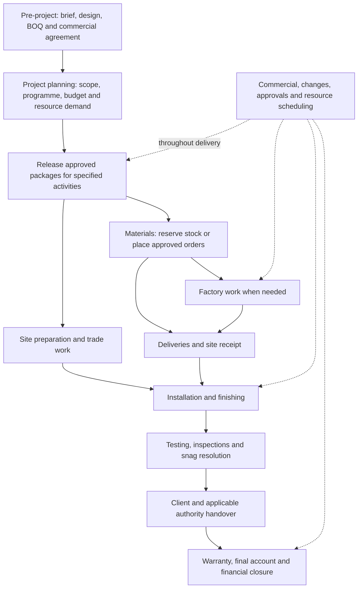

# Projects operating flow for Dubai interior fit-out

Current scope authority: [Projects module — v1 scope baseline](projects-scope-v1.md). It supersedes the navigation and incremental build order below, elevating tasks, subtasks, comments and daily reporting into the execution foundation. The research below remains supporting background.

Research date: 7 September 2026. Status: recommended product design for review, not a claim that these workflows are implemented or that the client has confirmed its operating model.

Implementation update: the selected ten-tab navigation and demo flow guides are recorded in [Project tabs and delivery cycle](projects-navigation.md). Production retains its label, Material planning remains separate from Procurement, and Commercial contains Change requests. The recommendations below are research background; operational workflows remain planned.

## 1. Recommended operating model

Build Projects around a mixed delivery model. One contract can involve company employees, an owned workshop, external manufacturers, material suppliers, and specialist subcontractors. Do not require a company to own a factory. Configure owned facilities only when they exist; external fabrication works without them.

Pre-project defines and agrees the work. Projects plans and delivers the work. The same customer, agreed scope, drawings, commercial records, and approval evidence stay connected across both modules.

A project contains **work packages**: manageable pieces of scope such as bedroom wardrobes, bathroom waterproofing, electrical first fix, or loose furniture. Each package connects its scope, dependencies, materials, responsible people, orders, bookings, inspections, and costs. A package can contain several operations performed in different places by different parties.

The project manager coordinates these activities in parallel. The whole project does not have to pass through procurement, then production, then installation as one rigid sequence.

**Production means off-site manufacture or fabrication of custom items.** In the interface, use **Factory work**, with the description “Custom items made by your workshop or an outside manufacturer.” Site-built fabrication belongs to Site work. Purchased standard products do not need artificial factory stages.

## 2. What the research establishes

Company publications describe their own practices; they do not establish that every Dubai contractor operates identically. The workflow below is a product recommendation synthesized from these sources.

| Primary evidence | Finding | Product implication |
|---|---|---|
| [Summertown: design and build](https://www.summertown.ae/the-shift-to-design-and-build-commercial-interior-contracts/) | Describes its own labour alongside subcontractors, scope/BOQ development, design coordination, and early sourcing of long-lead items. | Support mixed delivery and overlapping planning, approvals, and sourcing. |
| [Designsmith: Dubai joinery project manager responsibilities](https://erp.designsmith.ae/jobs/designsmith_interior_works_llc/project-manager---joinery) | Connects resource plans, schedules, budgets, cash flow, factory production, procurement, site installation, and variations across multiple projects. | Factory tracking alone cannot serve as the Projects module. |
| [Depa: manufacturing and procurement](https://depa.com/services/ffe-manufacturing-and-procurement/) | Describes custom in-house manufacture alongside sourcing from external manufacturers and suppliers, with drawing and sample coordination. | Keep manufacture, standard purchasing, and installation connected but distinguishable. This is a regional industry reference. |
| [Summertown: procurement reporting](https://www.summertown.ae/wp-content/uploads/2023/09/RA_SummerTown_V7_01_compressed.pdf) | Describes project procurement schedules, coordination with finance for advances, supplier risks, and post-project supplier evaluation. | Orders need required dates, payment terms, risk tracking, and performance records. |
| [Summertown: supplier assessment](https://www.summertown.ae/wp-content/uploads/2025/09/2023-24-Summertown-Sustainability-Report.pdf) | Describes prequalification of suppliers/subcontractors and quality visits to joinery units. | Vendor selection includes capability, compliance, and quality, alongside price. |
| [Dubai Development Authority: fit-out permit](https://dda.gov.ae/en/planning-development/construction/permits-nocs/fit-out-permit) | Lists appointment, tenancy, owner NOC, relevant authority NOCs, and drawing requirements for its fit-out permit. | Readiness must include the applicable permit and approved drawing set. DDA requirements are not a universal checklist for every Dubai property. |
| [DDA: completion certificate](https://dda.gov.ae/en/planning-development/construction/inspections-completions/fit-out-completion-certificate) | Connects completion to approved drawings and includes Dubai Civil Defense completion documentation. | Physical completion, authority completion, and client acceptance are separate evidence. |
| [Emaar Community Management: home modifications](https://www.ecm.ae/en/communities/dubai-marina/lifestyle/faqs/home-modifications-dubai-marina/) and [contractor access guidance](https://www.ecm.ae/wp-content/uploads/2025/06/UAQ_Q2_2025_Mobile.pdf) | Describes modification NOCs and registration/permits for contractors, staff, and vehicles. | Record community permissions and access readiness separately from assigning a team. |
| [Concordia: JLT fit-out processes](https://ondemand.concordiadubai.com/fo/) | Distinguishes normal, minor, revised drawing submissions, conformity, and completion processes. | Approval requirements depend on the location and the actual work; revisions can require resubmission. |
| [RICS: interim valuations and payment](https://www.rics.org/profession-standards/rics-standards-and-guidance/sector-standards/construction-standards/black-book/interim-valuations-and-payment) and [change control](https://www.rics.org/profession-standards/rics-standards-and-guidance/sector-standards/construction-standards/black-book/change-control-and-management-1st-edition2) | Treat payment mechanisms, retention, valuation, and contract-specific change procedures as distinct controls. | Configure commercial terms; distinguish submitted claims, certified amounts, invoices, and cash receipts. RICS is used for professional process concepts, not as UAE legislation. |

Public evidence does not establish this client's factory ownership, real crew availability, agreed payment percentages, actual productivity, or warranty terms. The proposed model supports those differences through configuration, without inventing defaults.

## 3. End-to-end flow

The diagram is a summary. Dependencies apply to packages, areas, and quantities. Material ordering, factory batches, first-fix site work, and inspections can overlap where their individual prerequisites allow it.

| Stage | Responsible lead | Required result |
|---|---|---|
| Transfer scope and prepare the project | Project manager with commercial/design leads | Linked source case, project manager, contract basis, locations, scope revision, budget, target dates, and a visible list of missing decisions. |
| Develop the execution plan | Project manager, site lead, factory planner where applicable | Work packages, dependencies, durations, required skills/capacity, materials needed by date, and procurement lead times. |
| Resolve technical and site readiness | Design/technical lead and permit coordinator | Relevant coordinated drawings, samples, measurements, method/inspection requirements, permissions, and access windows. |
| Authorize the relevant activities | Named technical/commercial/operations approvers | Auditable release of the specific scope and revision for purchasing, manufacture, or site work. |
| Source and execute | Buyer, storekeeper, workshop lead, site supervisor, subcontractors | Accepted orders, stock reservations, confirmed resource bookings, controlled factory/site work, and actual progress. |
| Deliver and install | Logistics lead and site supervisor | Quantity-level receipt and acceptance, installation-ready areas, confirmed crews, completed installation. |
| Inspect and hand over | Quality lead, project manager, client/consultant, applicable authority | Verified work, commissioning evidence, resolved blocking defects, approved handover records and documents. |
| Close remaining obligations | Commercial lead, finance, project manager | Final account, receivables/payables follow-up, retention and warranty obligations, deposit recovery, and closure record. |

### Starting while Pre-project is unfinished

Create or reuse a **Planning** project linked to a source case. Permit scope planning, task preparation, resource demand forecasts, draft purchase requirements, and draft budgets. Mark missing approvals explicitly.

Creating this record must not imply that a contract is signed, a payment has cleared, a permit is issued, an external order is authorized, or a factory job is released. Planning can start while those facts are unresolved. Commercial commitments and execution require their own release.

Keep one project per case for the first implementation, matching the current Business Core relationship. Handle partial handover and phased delivery through package/area releases rather than creating duplicate projects.

### Technical coordination continues during delivery

Pre-project remains the source of the original design and agreement. Projects must also support execution queries, revised shop drawings, sample approvals, site measurements, and clarification requests. A rendering approval is not automatically a fabrication drawing approval. Record the required reviewer for each document type: client, designer, consultant, authority, or internal technical lead.

A drawing revision must identify affected packages, quantities already made or bought, approval changes, cost/time consequences, and any work that must stop. Unaffected approved packages can continue.

## 4. Scope, orders, and responsibilities

Use these terms consistently:

| Record | Meaning | Example |
|---|---|---|
| Work package | The defined piece of project scope | Supply and install primary-bedroom wardrobes. |
| Task or operation | An activity within that scope | Verify dimensions, manufacture carcasses, deliver, install. |
| Purchase order | Commercial instruction to an external supplier | Buy specified boards and hardware. |
| Subcontract order | Commercial appointment for an external work package | Supply and install glazing to approved specification. |
| Factory job | Instruction to make specific items/quantities to an approved revision | Fabricate four wardrobe units. |
| Resource booking | Reservation of named capacity for dates/shifts | Installation crew A, all four workers, 14–16 September. |
| Receipt or service certificate | Evidence of accepted goods or measured work | Three units accepted; one damaged and rejected. |
| Client variation | A controlled change to the client scope/value/time | Add an island with revised cost and completion date. |

A project assignment grants responsibility or access. A resource booking reserves availability. Both may refer to the same person, but they must not be the same record.

### Delivery choices within a project

| Scope | Supply and execution route |
|---|---|
| Standard lights or chairs | Buy from a supplier; receive and inspect; deliver/install if required. |
| Wardrobe made in an owned workshop | Buy or issue materials; create factory job; reserve work centres and labour; inspect; dispatch; install. |
| Wardrobe made by an outside factory | Place an external fabrication order; obtain drawings/sample approval and confirmed dates; inspect; receive; install by the contracted party. |
| Painting, partitions, electrical or plumbing work | Assign an internal trade crew or issue a subcontract order; link material responsibility and site dependencies. |
| Client-supplied appliances or nominated finishes | Track client/vendor responsibility, delivery date, custody, inspection, and installation; record company purchase cost only when the company actually incurs it. |

Track **where the work happens**, **who performs it**, and **how materials are supplied** separately. A factory-made item can be installed by an outside crew. A subcontractor may supply all materials, use company-supplied materials, or provide labour only.

The quantity and responsibility split must reconcile back to the approved scope. Do not purchase materials already included in a supplier's supply-and-install package unless explicitly excluded or supplied free issue.

## 5. Team and factory allocation: core product requirement

Provide one company-wide calendar shared by all projects. Project views show the relevant slice of the same bookings. The operations/resource manager resolves priorities across projects; an individual project manager cannot silently take a crew already committed elsewhere.

The scheduling design below is our recommendation. [Odoo's work-centre documentation](https://www.odoo.com/documentation/19.0/applications/inventory_and_mrp/manufacturing/advanced_configuration/using_work_centers.html) provides a useful implementation reference for capacity, working calendars, setup time, alternate work centres, and eligible operators; it does not establish this client's scheduling policy.

### Booking flow

1. Choose the package/task and required skill or work centre.
2. Enter required headcount or effort, duration, location, and preferred date range.
3. Display available capacity and existing commitments across all projects.
4. Make a tentative reservation for planning; show its overlaps and expiry explicitly.
5. Check material, access, technical, predecessor, and release readiness.
6. Confirm the booking with the named responsible manager. An external supplier confirms its promised production/delivery slot; the product must not claim visibility of that supplier's undisclosed factory calendar.
7. Record actual start, attendance/time allocation, accepted output, remaining effort, and forecast finish.
8. If an overrun affects later bookings, show the impacted projects and proposed changes for the resource manager to resolve.

**Confirmed commitments consume capacity. Tentative reservations are visible demand, not a hidden guarantee.** For the first release, book complete named crews per shift and prevent overlapping confirmed crew bookings. Add partial-crew allocation only when named worker membership and capacity can be validated.

When supporting partial allocations, validate the actual workers and required skills. A person allocated through a team must not also be booked individually elsewhere. Team membership needs effective dates, so later roster edits do not rewrite historical attendance or bookings.

For factory work, check the relevant work centre and the required operator/team together. A free machine does not mean the operator is available; a free operator does not mean the machine is available. External factories need confirmed commitments and updated forecasts, not fictitious internal machine scheduling.

For an external labour provider, record the agreed crew or headcount, skills, dates, and acknowledgement. The company-wide calendar shows commitments known to this company; it does not claim to know that provider's bookings with other customers. Named subcontract workers can still be checked against known project access and site bookings.

Working calendars include shifts, leave, holidays, downtime, breaks where applicable, site access windows, and travel/setup allowances. Use the project/organisation calendar in Asia/Dubai by default for Dubai jobs; do not copy an assumed eight-hour day or an overseas workweek.

An overrun is never made invisible by the original planned end date. The task remains active until its actual finish is recorded; update its forecast and raise conflicts against later bookings. Rescheduling preserves the original baseline, the current forecast, who changed it, why, and the effect on customer commitments. Capacity checks must run atomically on confirmation so two managers cannot both reserve the last available slot.

### Example of the client's concern

Illustrative dates, not a market productivity estimate:

- Crew A has four installers, all confirmed on Villa A through 16 September.
- Office B requests the same full crew on 15–17 September.
- The system shows a conflict on 15–16 September and prevents confirmation.
- The resource manager can move B to the next valid available shift, select another qualified crew, or agree a subcontracted solution and its cost.
- If A later forecasts completion on 18 September, the proposed B booking is flagged again. Neither customer's date changes silently.
- Even with a free crew, installation remains blocked if the relevant joinery has not passed inspection or the destination area is not ready.

A monthly roster or attendance page alone does not solve this problem. Future commitments, current execution, and actual attendance must be connected.

## 6. Materials, vendors, procurement, and factory work

### Materials and procurement

For each package, determine the approved requirement and need-by date. Check usable stock, stock reserved for other jobs, and confirmed incoming supply. Allocate existing supply first; purchase only the remaining need. Draft demand is a forecast until approved. An unaccepted or late incoming delivery must not make a job appear ready.

Normal external purchasing follows:

**Requirement → stock check → quotation request → comparable offers → selection approval → purchase/subcontract order → supplier acknowledgement → delivery or service completion → inspection/acceptance → invoice verification → payment approval and settlement.**

Exceptions are explicit: a contractually nominated supplier, approved direct purchase, staged delivery, or advance payment can follow its authorized route. Do not force three quotations or receipt-before-payment when the signed arrangement provides another valid process. Advances have their own authorization and settlement record.

Offer comparison includes exact specification, quantity/unit, exclusions, freight, installation, tax treatment, lead time, payment terms, warranty, and delivery location. A cheap offer excluding installation is not directly comparable to a complete installed price.

Orders must retain approved revisions, quantities, rates, delivery commitments, acknowledgement, amendments, cancellation, and partial receipts. Receive into the actual warehouse, factory, or site. Track accepted, rejected, returned, and outstanding quantities separately, including substitutes that need approval.

Maintain one shared vendor identity, with one or more capabilities: material supplier, manufacturer, subcontractor, labour supplier, logistics, or consultant. Store relevant qualification/insurance documents, expiry dates, contacts, payment terms, and performance. Project records link this identity instead of copying it. Bank-account changes require controlled verification by finance; they are not a casual project-field edit.

### Owned factory route

**Approved item/drawing revision and measurements → manufacturing bill of materials and operation route → material reservation/issue → confirmed work-centre and labour booking → released factory job → operation progress → quality acceptance → packing/dispatch → site receipt.**

Cutting, machining, edge treatment, assembly, finishing, and other operations follow the actual product's route. Do not impose one operation sequence on all joinery, metal, stone, or upholstery work. Track batch quantities, waste, rework, actual time, and accepted output. Partial batches can proceed independently if the linked scope and installation prerequisites permit it.

The BOQ selling quantity and manufacturing consumption are different. For example, the selling area of a wardrobe is not its board cutting area. Reusable catalog recipes can suggest operations and components, but actual measurements and an approved project revision control execution.

### External factory route

Keep the same item specifications, approvals, quantities, inspection, and delivery controls. The manufacturer supplies acknowledged production dates and progress evidence. Do not manufacture internal work-centre data that the company does not own or receive.

### Delivery is a separate event

Packed, dispatched, delivered, accepted, installed, and handed over are different facts. Book vehicle and unloading/access slots where relevant. Match dispatch and receipt quantities, record damage, and track remaining items. Installation planning uses accepted usable items and site readiness, not a supplier's “completed” message alone.

## 7. Site execution, quality, and handover

Site execution includes preparation, protection, demolition if required, civil works, mechanical/electrical/plumbing coordination, partitions/ceilings, waterproofing, finishes, installation, testing, and cleaning. Use project-specific templates; not every project needs every trade.

Plan dependencies by area and task. For example, a required concealed-services inspection precedes closing the affected ceiling. Approved dimensions and completed prerequisite finishes may be necessary before final joinery installation. Client-requested revisions can change those dependencies.

Daily reporting records actual workers and hours, quantities completed, photos, inspections, materials consumed, blockers, incidents, delay causes, and tomorrow's plan. Attendance proves presence; it is not proof that the scope is complete. Supervisors submit progress and appropriate reviewers verify it.

Quality starts with incoming materials and continues through factory and site inspections. Record the inspection checklist/version, acceptance criteria, evidence, inspector, result, and corrective work. Link failed work to a responsible party, due date, reinspection, and cost treatment.

For handover, collect applicable testing/commissioning records, approved as-built drawings, operating/maintenance information, warranties, manuals, keys/assets, training, and client/consultant acceptance. Track authority and community completion requirements separately from the client's signature. The [DDA completion process](https://dda.gov.ae/en/planning-development/construction/inspections-completions/fit-out-completion-certificate) illustrates why a completion certificate is a separate deliverable.

Block handover for unresolved safety-critical or mandatory compliance issues. Minor outstanding items can accompany a conditional or sectional handover only where the contract and authorized acceptance allow it, with an explicit outstanding list and dates. Do not silently mark defects resolved to make the project look complete.

Warranty and defect-obligation dates follow the contract and, where relevant, individual area/item handovers. Keep defects, retained money, supplier warranty claims, and final closure visible after physical handover.

## 8. Commercial control throughout the project

Project Commercial is the connected view of the client agreement, budget, changes, earned/certified work, receipts, costs, and forecast. It must not create a second independent contract or payment ledger after the Pre-project handoff.

| Commercial area | Required behaviour |
|---|---|
| Contract and baseline | Preserve signed agreement, accepted scope revision, exclusions, original value, approved changes, and current value. Separate selling prices from internal costs. |
| Internal budget | Allocate materials, internal labour, factory operations, subcontractors, logistics, overhead, and contingency using the firm's approved costing basis. |
| Client billing | Support milestone-based billing and measured progress/payment applications. Where certification is required, track submitted and certified values separately; invoice timing follows the actual contract and applicable tax treatment. |
| Client receipts | Record due, invoiced, received, unapplied advances, overdue amounts, credits/refunds, and reconciled receipt evidence. An invoice is not cash received. |
| Vendor/subcontract payments | Match ordinary goods bills to orders and accepted receipts; match subcontract bills to the order and verified work. Record exceptions and approved advances separately. |
| Variations and claims | Record instruction/request, entitlement review, estimated cost/time impact, quotation, authorization, execution, valuation, and recovery. Pending recovery is visible risk, not automatically approved revenue. |
| Retention and deposits | Configure whether they apply, amounts/rates/caps, release conditions, due dates, and recovery. Do not impose a universal retention percentage or duration. |
| Cost and forecast | Show original/revised budget, incurred actual cost including appropriate accruals, remaining commitments, forecast uncommitted work, and risk allowance without double counting. |
| Cash flow | Forecast customer collections and supplier/payroll/other outflows by date. Keep cash position distinct from profitability. |

A practical internal cost forecast is **incurred cost + remaining committed cost + forecast uncommitted cost + explicit remaining risk allowance**. These categories must be disjoint. Moving a purchase from commitment to incurred cost reduces the outstanding commitment. The need to report incurred and foreseeable costs is supported by [RICS cost reporting](https://www.rics.org/content/dam/ricsglobal/documents/standards/cost_reporting_1st_edition_rics.pdf); the exact ledger mapping is an implementation decision.

Avoid counting the same expense twice: warehouse purchase and project material issue, workshop material issue and finished-item transfer, payroll and allocated labour time, or subcontractor attendance and the same subcontract bill. Contractor attendance can measure productivity without becoming a second payable.

A client change does not automatically justify a price increase; a documented contract instruction may also require action before its final value is agreed. Support authorized work with unresolved valuation, approval limits, and risk visibility. Never silently rewrite the signed baseline. [RICS change control](https://www.rics.org/profession-standards/rics-standards-and-guidance/sector-standards/construction-standards/black-book/change-control-and-management-1st-edition2) supports using the actual contract's change procedure.

Keep **delivery state** and **financial state** separate. A handed-over project may still have agreed credit, final-account negotiations, or retention outstanding. Whether a particular payment is a release or handover prerequisite is a recorded contract/business rule, not a universal “100% paid first” rule.

## 9. Release checks and lifecycle

Readiness is evaluated for the requested activity and affected scope revision.

| Activity | Checks before authorizing it |
|---|---|
| Draft planning | Valid source case, workspace permission, identified scope assumptions; missing approvals remain visible. |
| External commitment | Approved purchase/subcontract scope/specification, delegated budget authority, selected vendor/terms, commercial authorization, and any prerequisite client/technical decisions. |
| Factory start | Released quantities/revision, production-suitable drawings and measurements, applicable approvals, usable materials, available booked work centre/team, relevant commercial conditions. |
| Site start | Released work, applicable permits/access, technical information, safe work arrangements, predecessor readiness, required materials/equipment, confirmed qualified crew. |
| Dispatch | Accepted goods, package identification, destination readiness, transport/access booking, and applicable contractual release conditions. |
| Handover | Defined scope completed/accepted, required inspections and documents, applicable authority/community completion, accepted outstanding-item schedule if allowed, and contractual handover conditions. |
| Financial closure | Final account/disputes resolved or formally transferred, outstanding liabilities/receivables/retention addressed, records reconciled, authorized closure. |

Release records store their scope, quantity, document revisions, approver, date, and evidence. Invalidation of a relevant prerequisite raises an impact review; it does not erase history. An internal override cannot represent a missing statutory approval as obtained.

Suggested project delivery states: **Planning → Active → Handover → Warranty → Closed**. Store On hold/Cancelled as explicit controlled states or flags with reasons and affected commitments. Financial status is a separate summary. Package progress and blockers are separate from overall project status; a project can contain packages at different stages.

Task state: **Planned → Ready → In progress → Submitted for inspection → Accepted**, with blocked/rework/cancelled paths. Booking state: **Tentative → Confirmed → In progress → Completed**, with cancelled/superseded paths. A task completion must not automatically release all project resources or certify a client invoice.

## 10. Product navigation and ownership

Keep the Projects entry as the agreed table. Add access to a company-wide team/factory schedule when implementing resource planning. Selecting a project opens these destinations:

| Destination | Contents |
|---|---|
| Overview | Milestones, current blockers, decisions due, approaching deliveries/bookings, project health. |
| Plan & teams | Scope packages, programme/dependencies, task list, resource demand, bookings and workload. |
| Materials & procurement | Material requirements, stock allocations, sourcing, orders, receipts, deliveries, linked vendor bills. |
| Factory work | Internal jobs and external fabrication progress; relevant only for manufactured scope. |
| Site work | Area/trade execution, installation, daily reports, actual effort/output and blockers. |
| Quality & snags | Incoming/factory/site checks, defects, rework and verification. |
| Commercial | Contract, budget, variations/claims, client billing/receipts, costs, forecasts, retention. |
| Handover & warranty | Area/project handovers, document checklist, outstanding obligations and defects. |
| Files & approvals | Linked drawings, revisions, technical queries, decision history and approval requests. |

Documents and approvals appear contextually in each workflow but remain the same underlying records. Shared vendor data belongs to the vendor/procurement master; employees, employment calendars, and leave belong to workforce/HR. Projects owns work demand, task progress, and resource bookings. Finance owns authoritative posting and settlement. Technical reviewers own their approval decisions.

Small businesses may give one person several roles. Keep the permissions and approval responsibilities explicit even then. Client-facing views show approved scope, agreed dates, published progress, requested decisions, accepted variations, billing and handover. Internal margins, wages, vendor negotiations, private notes, and unapproved forecasts stay permission-controlled.

## 11. What exists in this repository, and what must change

This was a targeted source review, not a complete backend audit. The code is stronger evidence of current behaviour than historical overview documents.

- [Projects list](../apps/web/components/projects/projects-list-page.tsx) still displays a local demo. [Project section pages](../apps/web/app/workspace/projects/demo/[[...section]]/page.tsx) explicitly say their execution workflows are not connected.
- [Business Core Projects service](../services/business-core/src/projects/projects.service.ts) already contains a delivery-project foundation, assignments, and site-attendance access. Its release method checks an active pre-project and a won opportunity. That is not a complete technical/commercial execution release contract.
- [Migration 0030](../services/business-core/drizzle/0030_hrms_attendance_leave.sql) gives one delivery project per case and assignment records without booking dates or resource capacity. Those assignments cannot prevent future scheduling conflicts. The delivery status and work-location models need extension for this plan.
- The older [Python project service](../../backend/app/services/project_service.py) and [project models](../../backend/app/models/project.py) contain production release, variations, handover, and labour-team concepts. Their team assignment checks duplicate assignment to the same project rather than dated cross-project capacity. The existing handover gate also requires final payment received; evaluate that against the proposed contract-specific policy before reusing it.
- [Pre-project navigation notes](pre-project-navigation.md) establish linked commercial records and distinct approval/payment/release decisions. Some historical documents describe flows that are not connected in the newer web portal. Do not portray them as delivered features.

Use the current Business Core as the proposed authority for the new portal, subject to confirming the integration architecture. Reuse older business concepts only after mapping identifiers, permissions, and record ownership. Do not create two independently writable sources for the same contract, order, or payment.

### Build in this order

1. **Foundation and handoff:** real project list/detail, Planning state, stable source-case relationship, scope/location packages, PM ownership, baseline/version references, permissions and activity log. Agree the release evidence contract with Pre-project now; develop against clearly marked fixtures while its screens are unfinished.
2. **Plan and resource bookings:** tasks, dependencies, calendars, named whole-crew bookings across projects, readiness, conflicts and rescheduling. This addresses the client's allocation concern before detailed factory optimization.
3. **Materials and commercial controls:** approved demand, stock allocation, purchasing/subcontract commitments, vendor dates, receipts, initial budget/cost commitments, client terms, variations and payment visibility. Basic spend/change control is required before real orders go live.
4. **Execution:** simple factory jobs/external fabrication tracking and site work orders, daily reports, actual time/output, delivery coordination, inspections and rework. Start with manually confirmed schedules; advanced nesting and automatic optimization can wait.
5. **Handover and settlement:** commissioning, snags, sectional/project acceptance, warranty, final account/retention and financial reconciliation. Extend forecasting and reporting after the underlying records are reliable.

Each increment must deliver a usable path through real records. Do not present navigation placeholders as operating workflows. An external manufacturer's live capacity or an automated accounting integration is not an assumed launch dependency; manual evidence-backed acknowledgement and reconciliation are valid first steps.

### Minimum linked records

Source case and opportunity; delivery project; location/area; scope baseline and lines; work package; task/operation and dependencies; technical document revision and approval; release authorization; material requirement/reservation/issue; vendor; purchase/subcontract order and revisions; factory job; resource/calendar/team membership; dated booking; progress/time allocation; delivery/receipt/inspection; defect/rework; variation/instruction; valuation/certificate/invoice/receipt; cost/commitment reference; handover and warranty obligation.

Keep stable links at line/quantity level. A purchase order may cover several packages, and a package may require several orders. Allocation records must reconcile quantities and values instead of duplicating them.

### Acceptance scenarios before live use

- Two managers attempt to confirm the same full crew for overlapping shifts; only one succeeds.
- A worker belongs to a booked crew and is also selected for another job; no double allocation is possible.
- A task runs past its forecast; the next booking becomes a visible conflict rather than showing the crew as free.
- A drawing changes after a purchase/factory release; affected scope is reviewed without silently changing issued orders.
- Procurement receives only part of an order, with some rejected; readiness and billing use accepted quantities.
- A manufactured batch passes factory QC but the site is not ready; dispatch/installation do not appear ready automatically.
- A supplier provides materials and installation; the same materials and labour are not bought or costed twice.
- A subcontract crew submits attendance; no duplicate wages payable is created for work already included in its order.
- A client supplies an appliance; its arrival and responsibility are tracked without inventing a company purchase.
- A permitted variation starts before final price agreement; authority and financial exposure remain visible.
- One area is handed over while another continues; quantities, defects, warranties and client claims remain attributable.
- Physical handover occurs while contractually permitted retention remains; delivery can finish without falsely closing finance.

## 12. Client explanation

“We agree what must be delivered, split it into manageable work, and plan the people, materials and dates together. Every team or factory job is booked against real availability. Purchasing, factory work and site work progress together, with approvals and costs visible throughout. We then inspect, hand over, and track the remaining warranty and payment obligations.”

This is the recommended default flow. Factory ownership, approval jurisdiction, payment schedules, trade templates, warranty periods and actual calendars are configured from the client's facts when onboarding; none needs to be guessed to establish the product structure now.
